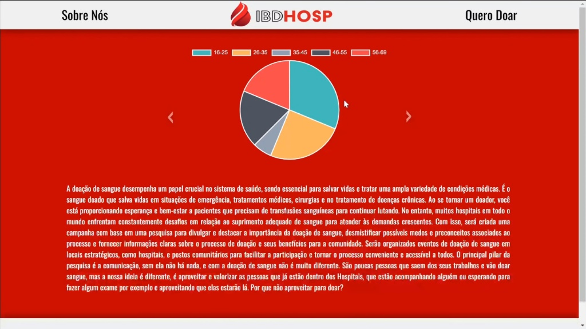
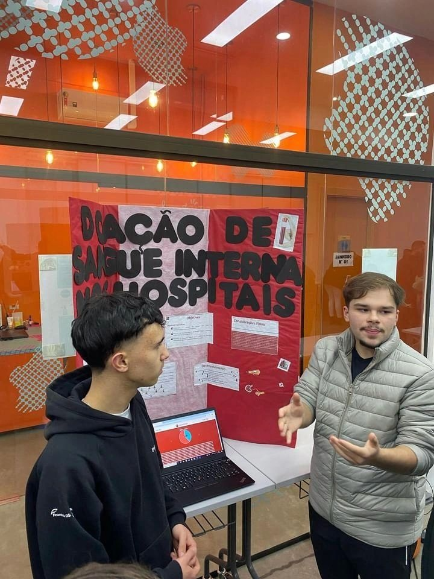

# IBDHosp - Campanha de Doação de Sangue Interna nos Hospitais

## Visão Geral

IBDHosp (Internal Blood Donation in Hospitals) é um projeto de pesquisa e desenvolvimento web criado para incentivar a doação de sangue por parte de pessoas que já se encontram no ambiente hospitalar, como acompanhantes, visitantes ou pacientes aguardando procedimentos.

O projeto nasceu da percepção de que os hemocentros enfrentam uma dificuldade crônica para manter seus estoques de sangue. A nossa abordagem inovadora busca otimizar a captação de doadores ao focar em um público que já está fisicamente presente nos hospitais, tornando o ato de doar mais conveniente e acessível.

Esta plataforma web serve como a face digital da campanha, atuando como um protótipo funcional (MVP). O sistema simula perfeitamente o fluxo de cadastro através de um formulário e exibe gráficos gerados com dados de teste (fictícios) para homologação e validação das funcionalidades do software. Cabe ressaltar que, por se tratar de um projeto de pesquisa acadêmica em ambiente controlado, não foi realizada uma coleta de dados real com pacientes ou visitantes dentro dos hospitais.

<p align="center">
  
</p>

## Impacto Corporativo e Pesquisa
- **Pitch Executivo:** O modelo de negócio e a plataforma foram apresentados em um pitch para o **ATRION**(Centro de Inovação do Hospital Moinhos de Vento).
- **Apresentação Corporativa:** O sistema foi demonstrado em um auditório para mais de 70 profissionais de diversos setores da **Unimed Porto Alegre**.
- **Validação Científica:** O desenvolvimento culminou na escrita de um artigo científico, validado e exposto em duas edições consecutivas de feiras técnicas.

<p align="center">
  
</p>

## Funcionalidades

- **Página Inicial (`index.php`):** Apresenta a justificativa do projeto e exibe gráficos dinâmicos com dados das doações, como faixa etária dos doadores e hospitais com mais registros.
- **Formulário de Doação (`forms.html`):** Permite que usuários interessados em doar preencham um formulário, fornecendo dados valiosos para a pesquisa e para o contato do hemocentro.
- **Sobre Nós (`sobre-nos.html`):** Apresenta os desenvolvedores do projeto.
- **Visualização de Dados:** Utiliza a biblioteca Chart.js para gerar gráficos interativos que ajudam a visualizar o perfil dos doadores e o alcance da campanha.

## Tecnologias Utilizadas

- **Frontend:**
  - HTML5
  - CSS3
  - JavaScript
  - **Chart.js:** Biblioteca para a criação dos gráficos.

- **Backend:**
  - PHP 8.0 (Arquitetura Cliente-Servidor)

- **Banco de Dados:**
  - MySQL (via MariaDB)

- **Servidor:**
  - O projeto foi desenvolvido e testado em um ambiente XAMPP.

## Estrutura do Projeto

```
/
├── action_page.php             # Processa os dados do formulário
├── forms.html                  # Página do formulário de doação
├── index.php                   # Página principal com gráficos
├── README.md                   # Este arquivo
├── sobre-nos.html              # Página sobre os desenvolvedores
├── assets/
│   ├── css/
│   │   ├── forms.css
│   │   ├── index.css
│   │   └── sobre-nos.css
│   ├── images/                 # Imagens e logos
│   └── js/
│       └── main.js             # Scripts JavaScript
└── config/
    ├── config.php              # Configuração da conexão com o banco de dados
    └── database_schema.sql     # Script de criação da tabela do banco de dados
```

## Banco de Dados

O projeto utiliza uma única tabela chamada `dados` para armazenar as informações coletadas no formulário.

**Estrutura da Tabela `dados`:**
```sql
CREATE TABLE `dados` (
  `id` int(11) NOT NULL AUTO_INCREMENT,
  `nome` varchar(255) NOT NULL,
  `idade` varchar(255) NOT NULL,
  `hospital` varchar(255) NOT NULL,
  `doou` varchar(255) NOT NULL,
  `motivo` varchar(255) NOT NULL,
  `data` int(11) NOT NULL,
  `hora` int(11) NOT NULL,
  PRIMARY KEY (`id`)
);
```

> **Nota de Homologação:** A tabela acima foi populada e testada exclusivamente com massa de dados simulada (dados de teste) para validar a persistência do banco, a comunicação com o PHP e a renderização dinâmica dos gráficos do Chart.js.

## Como Executar o Projeto

1.  **Pré-requisitos:**
    - Ter um ambiente de servidor local como XAMPP, WAMP ou MAMP instalado.
    - Ter um servidor de banco de dados MySQL ou MariaDB em execução.

2.  **Instalação:**
    - Clone ou baixe este repositório para o diretório `htdocs` (no caso do XAMPP) do seu servidor local.
    - Crie um novo banco de dados no seu phpMyAdmin (ou outro cliente SQL) com o nome `ibdhosp`.
    - Importe o arquivo `config/database_schema.sql` para dentro do banco de dados `ibdhosp` para criar a tabela `dados`.
    - Verifique o arquivo `config/config.php` e ajuste as credenciais de conexão com o banco de dados, se necessário.

3.  **Acesso:**
    - Inicie os módulos Apache e MySQL no seu painel de controle do XAMPP.
    - Abra seu navegador e acesse `http://localhost/doacaoDeSangueInternaNosHospitais/`.

## 👥 Desenvolvedores

| Desenvolvedor | GitHub | LinkedIn |
| :--- | :---: | :---: |
| **Vinícius Ross** | [](https://github.com/viniross) | [](https://linkedin.com/in/vinicius-ross) |
| **Lauro Vianna** | [](https://github.com/laurooo) | [](https://www.linkedin.com/in/lauro-abad-vianna-665566240?utm_source=share&utm_campaign=share_via&utm_content=profile&utm_medium=android_app) |
| **Matheus Cunha** | [](https://github.com/Matheus1464) | [](https://www.linkedin.com/in/matheus-cunha-7b5347284?utm_source=share&utm_campaign=share_via&utm_content=profile&utm_medium=android_app) |

---
*Projeto desenvolvido como parte da pesquisa sobre doação de sangue interna nos hospitais (2023-2024).*
